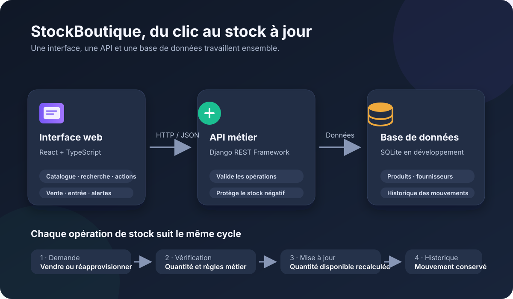
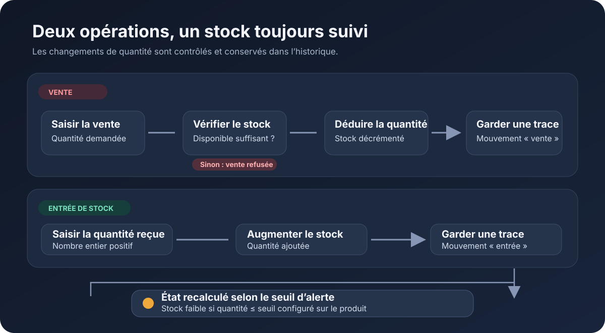
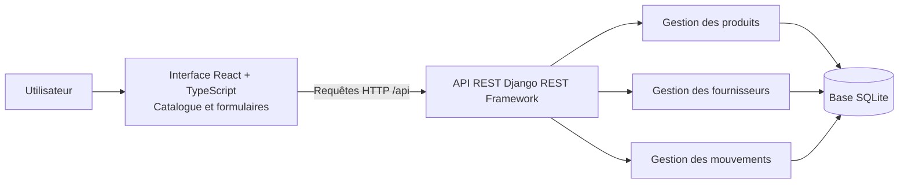
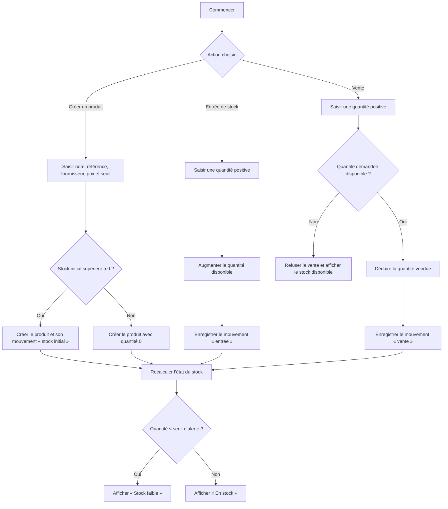
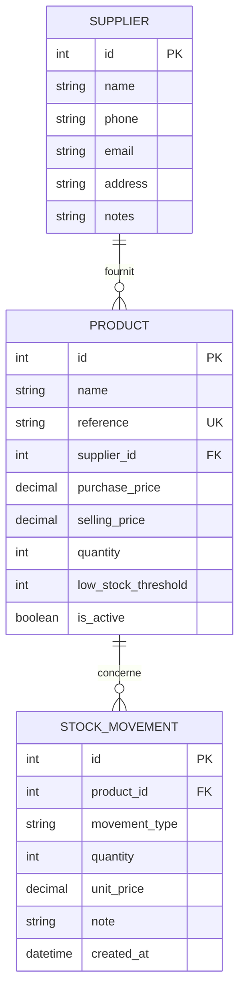
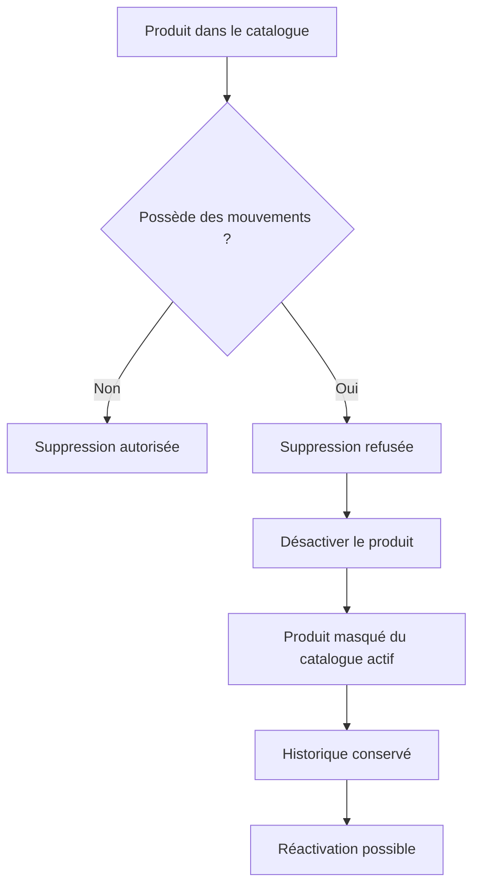

# Fonctionnement de StockBoutique

Ce document décrit le fonctionnement présent dans le code du projet. Les propositions d’évolution sont indiquées séparément à la fin.

## Illustrations

### Vue d’ensemble de la plateforme

### Vente et entrée de stock

## 1. Vue d’ensemble technique

L’interface charge les produits et fournisseurs via l’API. Les mouvements de stock mettent à jour la quantité du produit et ajoutent une ligne d’historique.

## 2. Parcours d’un produit et mouvements de stock

## 3. Modèle des données

Types de mouvements présents : `initial`, `entry`, `sale` et `adjustment`. Le parcours de création, d’entrée et de vente est implémenté dans l’interface et l’API ; l’ajustement existe dans le modèle de données, mais n’a pas encore d’action dédiée dans l’interface.

## 4. Catalogue et conservation de l’historique

## 5. Idées d’évolution

1. **Alerte de réapprovisionnement** : afficher les produits sous seuil dans une vue dédiée et proposer une quantité à commander.
2. **Gestion des corrections de stock** : ajouter une action d’ajustement avec motif obligatoire (inventaire, casse, perte, erreur de saisie).
3. **Historique consultable** : ajouter une page avec filtres par produit, type de mouvement et période, ainsi qu’un export CSV.
4. **Indicateurs de vente** : suivre le chiffre d’affaires et la marge à partir des ventes et des prix enregistrés au moment du mouvement.
5. **Sécurité multi-utilisateur** : authentification et rôles (administrateur, vendeur, gestionnaire), avec traçabilité de l’auteur de chaque opération.
6. **Fiabilité en production** : sauvegardes automatiques et base PostgreSQL pour mieux gérer plusieurs utilisateurs simultanés.

Les idées 5 et 6 sont particulièrement importantes avant d’exposer cette API sur Internet : le README précise actuellement que l’API autorise les requêtes sans authentification.
